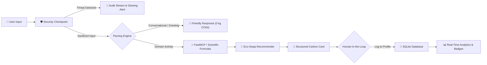

# 🌍 EcoTracker — Enterprise AI Sustainability Intelligence Platform


[](https://ecotracker-hjj5.onrender.com)
[](https://adk.dev/)
[](https://github.com/jlowin/fastmcp)
[](frontend/)
[](https://fastapi.tiangolo.com/)
[](tests/)
[](Dockerfile)

> 🚀 **Live Production Deployment:** **[https://ecotracker-hjj5.onrender.com](https://ecotracker-hjj5.onrender.com)**  
> An autonomous, enterprise-grade AI carbon intelligence platform that calculates lifestyle carbon footprints with scientific rigor, recommends high-impact eco-swaps, manages multi-tenant sustainability budgets, and enforces zero-trust security guardrails.

---

## 🌟 Highlights & Core Capabilities

- 💬 **Conversational AI Carbon Advisor** — Interactive full-screen chat with dialogue memory, multi-turn follow-ups (*"What about an electric train instead?"*), and grounded calculations using EPA, DEFRA, and Poore & Nemecek emissions datasets.
- 📐 **Scientific Tiered Calculation Engine** — Accurately distinguishes between:
  - **Explicit Numbers** (e.g. *"Drove 45 km"* ➔ `45 × 0.192 = 8.64 kg CO2e`).
  - **Activities without Numbers** (e.g. *"Drove my car"* ➔ transparent industry baseline benchmark of 25 km commute = `4.80 kg CO2e` with prompt to refine).
  - **Chit-chat & Random Input** (e.g. *"shutup"*, *"hello"*, gibberish ➔ `0.0 kg CO2e`, no synthetic fake calculations).
- 🎨 **Exquisite Carbon Result Cards** — Replaces messy CLI text dumps with modern visual cards featuring real-time emissions pills, formula breakdowns, emerald-accented eco-swap recommendations, and rich markdown via `marked.js`.
- 📸 **Multimodal Vision Intelligence** — Uses Gemini 2.5 Flash Vision OCR to extract line-item emissions from photos or scans of **grocery receipts** and **electricity utility bills**, identifying individual items and calculating instant green swaps.
- ⚡ **Live Regional Power Grid Tracking** — Connects to live grid carbon intensity APIs (UK National Grid ESO, US CAISO/ERCOT, EU) to compute exact dynamic $\text{g CO}_2\text{e}/\text{kWh}$ and recommend optimal clean-energy EV charging windows.
- ✈️ **Airport-to-Airport Flight Calculator** — Computes great-circle distances (Haversine formula), cabin class multipliers, DEFRA radiative forcing indices, and high-speed electric rail substitutions.
- 🔮 **Interactive "What-If" Climate & ROI Simulator** — Interactive scenario sliders modeling 1-year, 5-year, and 10-year cumulative $\text{CO}_2\text{e}$ abatement paired with household financial savings ($).
- 💼 **Enterprise ESG & Scope 1, 2, 3 Disclosure** — Aligned with the Greenhouse Gas (GHG) Protocol Corporate Standard, featuring cryptographic audit verification hashes and a 1-click printable executive PDF disclosure report.
- 📊 **Modern Linear/Vercel-Style SaaS Shell & Full Mobile/Desktop Responsiveness** —
  - 📱 **Mobile-First Responsive Layout** — Optimized touch navigation, bottom app bar for smartphones, floating action buttons, and responsive grid reflows for all screen sizes.
  - 🔤 **Large High-Legibility Typography Default Everywhere** — Built with generous 18px base typography, 17px chat bubbles, 15px+ meta labels, and 1.6 line height as the permanent default everywhere for effortless readability on all screens.
  - 🎙️ **Hands-Free Voice Speech-to-Text** — Integrated Web Speech API microphone dictation in chat with real-time audio pulse indicators.
  - 📲 **Progressive Web App (PWA)** — Offline-capable service worker (`/sw.js`) and web app manifest (`/manifest.json`) for seamless 1-click home screen installation on iOS and Android.
  - 🏆 **Community Sustainability Leaderboard** — Ranked leaderboards celebrating top carbon savers, entry counts, and unlocked achievement badges.
  - 📈 **30-Day Daily Carbon Trends** — Dual analytics charts: Category doughnut breakdown alongside a 30-day historical time-series line chart.
  - ⚠️ **Proactive Carbon Budget Alerts** — Automatic in-chat visual warnings at 80% and 100% daily emissions capacity.
  - 🌤️ **Ambient Weather Intelligence** — Live outdoor weather context badge via Open-Meteo API to inform HVAC and climate recommendations.
  - 🏷️ **1-Click Shareable Eco Impact Scorecard** — Instant pop-up card summarizing total avoided emissions and badges with clipboard sharing.
  - 10 Dedicated Views:
  1. **💬 AI Carbon Chat** — Conversational agent with voice input, avatars, animated typing indicators, and in-chat action pills.
  2. **📈 Analytics & Budget** — Real-time KPI metric cards, 30-day daily trend line chart, category doughnut, and daily budget target slider.
  3. **🏆 Community Leaderboard** — Team and global rankings with Gold/Silver/Bronze badges and carbon avoided totals.
  4. **⚡ Eco Habits Studio** — 1-click presets (*Morning Coffee*, *Train Commute*, *Plant-Based Lunch*, *Bicycle Ride*, *AC Eco-Scheduling*) with `canvas-confetti` celebrations.
  5. **📸 Vision Scanner** — Drag-and-drop document OCR dropzone with instant line-item breakdown.
  6. **🔮 What-If Simulator** — Interactive lifestyle and ROI transition modeling across multi-year horizons.
  7. **💼 Enterprise ESG** — Corporate Scope 1-2-3 accounting and printable executive balance sheets.
  8. **📋 Activity History** — Search filtering, category badges, individual row deletion, full wipe, and downloadable CSV report exports (`/api/export-csv`).
  9. **🌍 Carbon Offset Projects** — Verified Gold Standard & Verra VCS project directory with interactive offset portfolio slider.
- 🛡️ **Enterprise Zero-Trust Security Checkpoint** — Inspects and intercepts malicious inputs before LLM execution:
  - Regex-hardened prompt injection and persona jailbreak defense (`"ignore previous instructions"`, `"DAN mode"`).
  - Script injection and cross-site scripting (XSS) neutralization.
  - SQL injection protection (`UNION SELECT`, `DROP TABLE`).
  - Code execution barriers (`eval(`, `os.system`).
  - Context-aware credential leak prevention (Google AIza keys, GitHub tokens, Groq keys, SSNs).
  - Reversible PII scrubbing for emails, international phones, and street addresses while strictly preserving metrics (`45 km`, `250g`, `4 hours`).
- 💾 **Multi-Tenant SQLite Persistence** — Embedded transactional database (`ecotracker.db`) storing verified logs, daily budget utilization, and milestone badges (*First Step*, *Eco Habit*, *Carbon Saver*, *Climate Hero*).
- ☁️ **Cloud LLM Support & Containerization** — Supports free-tier Groq (`llama-3.3-70b-versatile`) and Gemini (`gemini-2.5-flash-lite`) alongside multi-stage `Dockerfile` and `render.yaml` for 1-click cloud deployment.

---

## 🏗️ Architecture




---

## 📦 Project Directory Structure

```
ecotracker/
├── app/
│   ├── services/         # Modular enterprise intelligence services
│   │   ├── vision_scanner.py   # Multimodal receipt & utility bill OCR via Gemini Vision
│   │   ├── grid_intensity.py   # Live regional power grid carbon intensity & smart charging
│   │   ├── flight_calculator.py# IATA airport-to-airport aviation & rail substitution
│   │   ├── simulator.py        # What-If sustainability & multi-year ROI simulator
│   │   └── esg_report.py       # GHG Protocol Scope 1-2-3 corporate accounting & PDF reporting
│   ├── dashboard.py      # Production FastAPI app, modern Linear App Shell, REST APIs
│   ├── engine.py         # Tiered calculation engine, conversational turn handler, baseline logic
│   ├── security.py       # Multi-layer enterprise security guardrails, PII scrubber, threat audit
│   ├── db.py             # Multi-tenant SQLite persistence, Scope 1-2-3 tagging, milestone badges
│   ├── mcp_server.py     # FastMCP server exposing 7 domain tools over stdio
│   ├── cloud_llm.py      # Cloud LLM client supporting Groq & Gemini multi-turn dialogue
│   ├── agent.py          # Google ADK 2.0 workflow graph, human-in-the-loop nodes
│   ├── config.py         # Environment configuration
│   └── __init__.py
├── assets/               # Architecture diagrams and cover graphics
├── tests/                # Automated pytest suite (26 tests, 100% pass)
│   ├── test_advanced_features.py # Vision OCR, live grid, flights, what-if simulator, Scope 1-2-3 ESG
│   ├── test_dashboard_api.py   # REST API lifecycle, CSV export, random input handling
│   ├── test_security.py        # Prompt injection, credential leaks, PII scrubbing
│   ├── test_mcp_server.py      # MCP domain emission tools and benchmarks
│   ├── test_db.py              # SQLite storage, badge triggers, deletions
│   └── test_workflow.py        # ADK workflow graph routing and approvals
├── Dockerfile            # Multi-stage production container with uv
├── render.yaml           # Automated 1-click Render cloud deployment blueprint
├── pyproject.toml        # Project dependencies and tool configurations
└── README.md
```

---

## ⚡ Quick Start

### 1. Prerequisites
- Python 3.11–3.13
- [`uv`](https://docs.astral.sh/uv/) package manager
- (Optional) Free [Gemini API Key](https://aistudio.google.com/apikey) or [Groq API Key](https://console.groq.com/)

### 2. Installation
```bash
git clone https://github.com/shravan3161/ecotracker-.git
cd ecotracker-
uv sync
```

### 3. Launch the Interactive Dashboard
```bash
uv run python -m app.dashboard
```
Open **[http://localhost:8085](http://localhost:8085)** in your browser to experience the full platform!

---

## 🧪 Automated Test Suite

Run all 20 automated unit and integration tests:

```bash
uv run pytest tests -v
```

```text
tests/test_advanced_features.py::test_multimodal_vision_scanner PASSED   [  3%]
tests/test_advanced_features.py::test_grid_carbon_intensity_service PASSED [  7%]
tests/test_advanced_features.py::test_flight_emissions_and_rail_benchmark PASSED [ 11%]
tests/test_advanced_features.py::test_what_if_scenario_simulator PASSED  [ 15%]
tests/test_advanced_features.py::test_enterprise_esg_disclosure_and_html_generation PASSED [ 19%]
tests/test_advanced_features.py::test_mcp_advanced_tools PASSED          [ 23%]
tests/test_dashboard_api.py::test_dashboard_full_lifecycle PASSED        [ 26%]
tests/test_dashboard_api.py::test_chat_dismissive_and_random_inputs PASSED [ 30%]
tests/test_db.py::test_log_calculation_and_summary PASSED                [ 34%]
tests/test_db.py::test_milestone_badges PASSED                           [ 38%]
tests/test_db.py::test_delete_log_and_clear_user_data PASSED             [ 42%]
tests/test_mcp_server.py::test_transit_emissions_gasoline_car PASSED     [ 46%]
tests/test_mcp_server.py::test_transit_emissions_train_and_walking PASSED [ 50%]
tests/test_mcp_server.py::test_appliance_efficiency PASSED               [ 53%]
tests/test_mcp_server.py::test_waste_offset PASSED                       [ 57%]
tests/test_mcp_server.py::test_dietary_emissions PASSED                  [ 61%]
tests/test_mcp_server.py::test_user_profile_summary PASSED               [ 65%]
tests/test_security.py::test_prompt_injection_blocked PASSED             [ 69%]
tests/test_security.py::test_credential_leak_blocked PASSED              [ 73%]
tests/test_security.py::test_pii_scrubbing_emails_and_phones PASSED      [ 76%]
tests/test_security.py::test_address_scrubbing_and_distance_preservation PASSED [ 80%]
tests/test_security.py::test_context_aware_credentials PASSED            [ 84%]
tests/test_workflow.py::test_security_checkpoint_node_pass PASSED        [ 88%]
tests/test_workflow.py::test_security_checkpoint_node_block PASSED       [ 92%]
tests/test_workflow.py::test_post_process_node_hitl_routing PASSED       [ 96%]
tests/test_workflow.py::test_post_process_node_auto_approved PASSED      [100%]

============================== 26 passed in 5.12s ==============================
```

---

## ☁️ Live Cloud Deployment

EcoTracker is deployed live in production on Render:

👉 **[https://ecotracker-hjj5.onrender.com](https://ecotracker-hjj5.onrender.com)**

Continuous deployment is active via [render.yaml](render.yaml) and [Dockerfile](Dockerfile). Any future updates pushed to `origin/master` automatically rebuild and redeploy within 60 seconds.

---

## 💬 Example Queries & Responses

| User Input | Engine Behavior | Calculated Impact |
|:---|:---|:---|
| `"I drove 45 km in a gasoline car"` | Exact numerical calculation | **8.64 kg CO2e** (Train swap saves 7.07 kg) |
| `"I drove to work"` | Activity detected without numbers | **4.80 kg CO2e** (uses standard 25 km commute baseline with prompt to refine) |
| `"Ate a 250g ribeye steak dinner"` | Food system calculation | **6.75 kg CO2e** (Plant-based swap saves 5.55 kg) |
| `"Ran my air conditioner for 6 hours"` | Appliance power calculation | **7.50 kg CO2e** (Smart scheduling saves 3.00 kg) |
| `"What about an electric train?"` | Conversational context memory | Compares against previous journey distance |
| `"Log this to my profile"` | Human-in-the-loop persistence | Stores in SQLite, updates daily budget, triggers badges |
| `"shutup" / "hello"` | Conversational classification | **0.0 kg CO2e** (no fake calculations or buttons) |
| `"<script>alert(1)</script>"` | Zero-trust security checkpoint | **Blocked** with security audit alert box |

---

## 🚀 Future Scope & Strategic Roadmap

EcoTracker is architected as an extensible, enterprise-grade sustainability intelligence platform. The roadmap below outlines the architectural evolution designed to transition EcoTracker from a conversational advisor into a ubiquitous, autonomous climate intelligence operating system:

### 1. 🔌 IoT & Smart Home Telemetry Ingestion (Matter / MQTT / Zigbee)
- **Zero-Manual Data Entry:** Direct telemetry streaming from smart plugs (Shelly, TP-Link Kasa) and smart thermostats (Google Nest, Ecobee) directly into the FastMCP appliance toolset.
- **Sub-Second Load Anomaly Alerts:** Proactively detect high-consumption vampire loads and faulty appliance draw before energy bills spike.

### 2. 💳 Open Banking & Automated Green Fintech Tracking (Plaid / Yapily)
- **Transactional Carbon Auditing:** Read-only bank connection utilizing Merchant Category Codes (MCCs) paired with EPA economic input-output (USEEIO) models.
- **Automated Lifestyle Footprinting:** Instant carbon attribution on grocery shopping, gas station fill-ups, and airline tickets with suggested offset bundles.

### 3. 🤖 Autonomous Agent-to-Agent (A2A) Microgrid Energy Auctions
- **Decentralized Load Scheduling:** Leveraging the Google ADK 2.0 multi-agent architecture to allow home energy agents to communicate with local solar microgrids and grid operators.
- **Dynamic EV Tariff Arbitrage:** Automatically schedules electric vehicle charging and home battery discharge during surplus renewable generation and negative wholesale price windows.

### 4. ⛓️ Decentralized On-Chain ESG Audit & Verification
- **Anti-Greenwashing Guarantee:** Immutable, cryptographically signed carbon retirement certificates recorded on eco-friendly distributed ledgers (e.g. Hedera Guardian, Toucan, Puro.earth).
- **Audit-Proof Corporate Disclosures:** Double-counting-proof tracking aligned with EU CSRD, SEC Climate Disclosure, and California SB 253 rules.

### 5. 📱 Cross-Platform Native Mobile Apps with Passive GPS Transit Detection
- **Sensor Fusion:** Transitioning the PWA into native React Native / Expo binaries with battery-optimized background geofencing and accelerometer sensor fusion.
- **Automated Journey Classification:** Passive recognition of walking, cycling, train commutes, and car journeys without requiring manual interaction.

### 6. 🏢 Enterprise Scope 3 Upstream Supply Chain Portal
- **Automated Supplier Ingestion:** Multi-tenant B2B portal allowing enterprises to invite tier-1 and tier-2 suppliers to complete automated AI carbon audits.
- **EDI / PEPPOL Invoice Carbon Ingestion:** Automated extraction of embodied line-item carbon from electronic supplier invoices.

---

## 🤝 Built With

- **[Google ADK 2.0](https://adk.dev/)** — Autonomous Agent Development Kit
- **[Model Context Protocol (FastMCP)](https://github.com/jlowin/fastmcp)** — High-performance domain tool integration
- **[FastAPI](https://fastapi.tiangolo.com/) & [Uvicorn](https://www.uvicorn.org/)** — Asynchronous web framework & ASGI servers
- **[Chart.js](https://www.chartjs.org/) & [Canvas-Confetti](https://github.com/catdad/canvas-confetti)** — Modern client-side visualizations
- **[Marked.js](https://marked.js.org/)** — Clean client-side markdown formatting
- **[SQLite3](https://www.sqlite.org/)** — Transactional multi-tenant persistence
- **[pytest](https://docs.pytest.org/)** — Rigorous automated test suite

---

## 📄 License

Licensed under the Apache License, Version 2.0.
