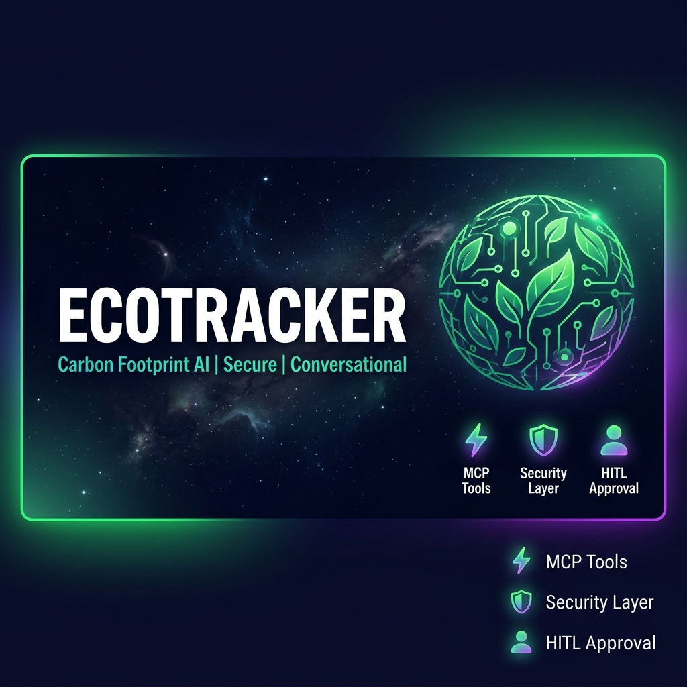
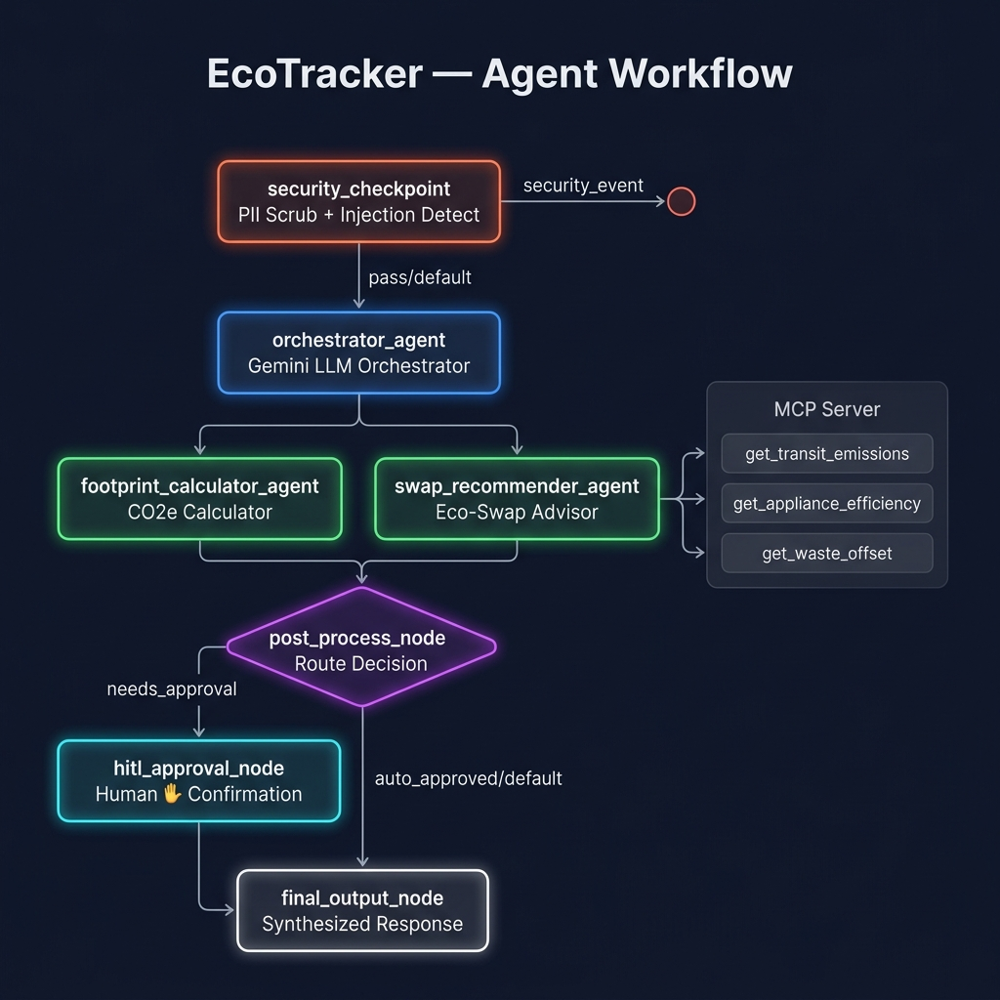
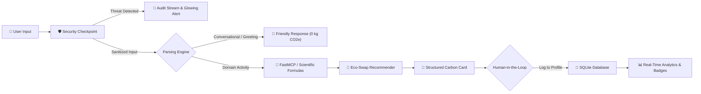

# 🌍 EcoTracker — Enterprise AI Sustainability Intelligence Platform



[](https://ecotracker-hjj5.onrender.com)
[](https://adk.dev/)
[](https://github.com/jlowin/fastmcp)
[](https://fastapi.tiangolo.com/)
[](tests/)
[](Dockerfile)

> 🚀 **Live Production Deployment:** **[https://ecotracker-hjj5.onrender.com](https://ecotracker-hjj5.onrender.com)**  
> An autonomous, enterprise-grade AI carbon intelligence platform that calculates lifestyle carbon footprints with scientific rigor, recommends high-impact eco-swaps, manages multi-tenant sustainability budgets, and enforces zero-trust security guardrails.

⚡ TL;DR
EcoTracker is a conversational AI agent that estimates your carbon footprint and suggests greener alternatives. It was built for a “Track 1: Agents for Good” submission using Google ADK 2.0 and Gemini.

What it does: You describe an activity (a 50 km drive, an old fridge, recycling 50 bottles) and it returns kg CO2e plus 2–3 eco-swap suggestions.
Architecture: Multi-agent workflow in app/agent.py, with a local FastMCP server (mcp_server.py) exposing three tools: transit emissions, appliance efficiency, and waste offset.
Security layer: Before any LLM call, it runs regex PII scrubbing, keyword-based prompt-injection blocking, and a credential filter, with audit logs to stdout.
Human-in-the-loop: It pauses for confirmation before logging anything to a user profile.
Run it: Python 3.11–3.13, uv sync, add a Gemini API key to .env, then uv run adk web app. The README recommends gemini-2.5-flash-lite for the free tier.
State of the repo: Small and early, with 4 commits, 0 stars and no license. It includes a demo script and a submission writeup. The README lists a tests/ folder, but it doesn’t appear in the root file listing, so it may be missing.
Limitations: Injection and credential detection is keyword-based, so it’s easy to bypass. The emission data comes from a local MCP server, so how “real” the factors are depends on what’s hardcoded there.
---

## 🌟 Highlights & Core Capabilities

- 💬 **Conversational AI Carbon Advisor** — Interactive full-screen chat with dialogue memory, multi-turn follow-ups (*"What about an electric train instead?"*), and grounded calculations using EPA, DEFRA, and Poore & Nemecek emissions datasets.
- 📐 **Scientific Tiered Calculation Engine** — Accurately distinguishes between:
  - **Explicit Numbers** (e.g. *"Drove 45 km"* ➔ `45 × 0.192 = 8.64 kg CO2e`).
  - **Activities without Numbers** (e.g. *"Drove my car"* ➔ transparent industry baseline benchmark of 25 km commute = `4.80 kg CO2e` with prompt to refine).
  - **Chit-chat & Random Input** (e.g. *"shutup"*, *"hello"*, gibberish ➔ `0.0 kg CO2e`, no synthetic fake calculations).
- 🎨 **Exquisite Carbon Result Cards** — Replaces messy CLI text dumps with modern visual cards featuring real-time emissions pills, formula breakdowns, emerald-accented eco-swap recommendations, and rich markdown via `marked.js`.
- 📊 **Modern Linear/Vercel-Style SaaS Shell** — Responsive sidebar navigation with 5 dedicated views:
  1. **💬 AI Carbon Chat** — Conversational agent with avatars, animated typing indicators, and in-chat 1-click action pills.
  2. **📈 Analytics & Budget** — Real-time KPI metric cards, Chart.js category distribution doughnut, and interactive daily budget target slider.
  3. **⚡ Eco Habits Studio** — 1-click presets (*Morning Coffee*, *Train Commute*, *Plant-Based Lunch*, *Bicycle Ride*, *AC Eco-Scheduling*) with `canvas-confetti` celebrations.
  4. **📋 Activity History** — Search filtering, category badges, individual row deletion, full wipe, and downloadable CSV report exports (`/api/export-csv`).
  5. **🌍 Carbon Offset Projects** — Verified Gold Standard & Verra VCS project directory with interactive offset portfolio slider.
- 🛡️ **Enterprise Zero-Trust Security Checkpoint** — Inspects and intercepts malicious inputs before LLM execution:
  - Regex-hardened prompt injection and persona jailbreak defense (`"ignore previous instructions"`, `"DAN mode"`).
  - Script injection and cross-site scripting (XSS) neutralization.
  - SQL injection protection (`UNION SELECT`, `DROP TABLE`).
  - Code execution barriers (`eval(`, `os.system`).
  - Context-aware credential leak prevention (Google AIza keys, GitHub tokens, Groq keys, SSNs).
  - Reversible PII scrubbing for emails, international phones, and street addresses while strictly preserving metrics (`45 km`, `250g`, `4 hours`).
- 💾 **Multi-Tenant SQLite Persistence** — Embedded transactional database (`ecotracker.db`) storing verified logs, daily budget utilization, and milestone badges (*First Step*, *Eco Habit*, *Carbon Saver*, *Climate Hero*).
- ☁️ **Cloud LLM Support & Containerization** — Supports free-tier Groq (`llama-3.3-70b-versatile`) and Gemini (`gemini-2.5-flash-lite`) alongside multi-stage `Dockerfile` and `render.yaml` for 1-click cloud deployment.

---

## 🏗️ Architecture





---

## 📦 Project Directory Structure

```
ecotracker/
├── app/
│   ├── dashboard.py      # Production FastAPI app, modern Linear App Shell, REST APIs
│   ├── engine.py         # Tiered calculation engine, conversational turn handler, baseline logic
│   ├── security.py       # Multi-layer enterprise security guardrails, PII scrubber, threat audit
│   ├── db.py             # Multi-tenant SQLite persistence, statistics, milestone badge engine
│   ├── mcp_server.py     # Local FastMCP server exposing 5 domain tools over stdio
│   ├── cloud_llm.py      # Cloud LLM client supporting Groq & Gemini multi-turn dialogue
│   ├── agent.py          # Google ADK 2.0 workflow graph, human-in-the-loop nodes
│   ├── config.py         # Environment configuration
│   └── __init__.py
├── assets/               # Architecture diagrams and cover graphics
├── tests/                # Automated pytest suite (20 tests, 100% pass)
│   ├── test_dashboard_api.py   # REST API lifecycle, CSV export, random input handling
│   ├── test_security.py        # Prompt injection, credential leaks, PII scrubbing
│   ├── test_mcp_server.py      # MCP domain emission tools and benchmarks
│   ├── test_db.py              # SQLite storage, badge triggers, deletions
│   └── test_workflow.py        # ADK workflow graph routing and approvals
├── Dockerfile            # Multi-stage production container with uv
├── render.yaml           # Automated 1-click Render cloud deployment blueprint
├── pyproject.toml        # Project dependencies and tool configurations
└── README.md
```

---

## ⚡ Quick Start

### 1. Prerequisites
- Python 3.11–3.13
- [`uv`](https://docs.astral.sh/uv/) package manager
- (Optional) Free [Gemini API Key](https://aistudio.google.com/apikey) or [Groq API Key](https://console.groq.com/)

### 2. Installation
```bash
git clone https://github.com/shravan3161/ecotracker-.git
cd ecotracker-
uv sync
```

### 3. Launch the Interactive Dashboard
```bash
uv run python -m app.dashboard
```
Open **[http://localhost:8085](http://localhost:8085)** in your browser to experience the full platform!

---

## 🧪 Automated Test Suite

Run all 20 automated unit and integration tests:

```bash
uv run pytest tests -v
```

```text
tests/test_dashboard_api.py::test_dashboard_full_lifecycle PASSED        [  5%]
tests/test_dashboard_api.py::test_chat_dismissive_and_random_inputs PASSED [ 10%]
tests/test_db.py::test_log_calculation_and_summary PASSED                [ 15%]
tests/test_db.py::test_milestone_badges PASSED                           [ 20%]
tests/test_db.py::test_delete_log_and_clear_user_data PASSED             [ 25%]
tests/test_mcp_server.py::test_transit_emissions_gasoline_car PASSED     [ 30%]
tests/test_mcp_server.py::test_transit_emissions_train_and_walking PASSED [ 35%]
tests/test_mcp_server.py::test_appliance_efficiency PASSED               [ 40%]
tests/test_mcp_server.py::test_waste_offset PASSED                       [ 45%]
tests/test_mcp_server.py::test_dietary_emissions PASSED                  [ 50%]
tests/test_mcp_server.py::test_user_profile_summary PASSED               [ 55%]
tests/test_security.py::test_prompt_injection_blocked PASSED             [ 60%]
tests/test_security.py::test_credential_leak_blocked PASSED              [ 65%]
tests/test_security.py::test_pii_scrubbing_emails_and_phones PASSED      [ 70%]
tests/test_security.py::test_address_scrubbing_and_distance_preservation PASSED [ 75%]
tests/test_security.py::test_context_aware_credentials PASSED            [ 80%]
tests/test_workflow.py::test_security_checkpoint_node_pass PASSED        [ 85%]
tests/test_workflow.py::test_security_checkpoint_node_block PASSED       [ 90%]
tests/test_workflow.py::test_post_process_node_hitl_routing PASSED       [ 95%]
tests/test_workflow.py::test_post_process_node_auto_approved PASSED      [100%]

============================= 20 passed in 4.75s ==============================
```

---

## ☁️ Live Cloud Deployment

EcoTracker is deployed live in production on Render:

👉 **[https://ecotracker-hjj5.onrender.com](https://ecotracker-hjj5.onrender.com)**

Continuous deployment is active via [render.yaml](render.yaml) and [Dockerfile](Dockerfile). Any future updates pushed to `origin/master` automatically rebuild and redeploy within 60 seconds.

---

## 💬 Example Queries & Responses

| User Input | Engine Behavior | Calculated Impact |
|:---|:---|:---|
| `"I drove 45 km in a gasoline car"` | Exact numerical calculation | **8.64 kg CO2e** (Train swap saves 7.07 kg) |
| `"I drove to work"` | Activity detected without numbers | **4.80 kg CO2e** (uses standard 25 km commute baseline with prompt to refine) |
| `"Ate a 250g ribeye steak dinner"` | Food system calculation | **6.75 kg CO2e** (Plant-based swap saves 5.55 kg) |
| `"Ran my air conditioner for 6 hours"` | Appliance power calculation | **7.50 kg CO2e** (Smart scheduling saves 3.00 kg) |
| `"What about an electric train?"` | Conversational context memory | Compares against previous journey distance |
| `"Log this to my profile"` | Human-in-the-loop persistence | Stores in SQLite, updates daily budget, triggers badges |
| `"shutup" / "hello"` | Conversational classification | **0.0 kg CO2e** (no fake calculations or buttons) |
| `"<script>alert(1)</script>"` | Zero-trust security checkpoint | **Blocked** with security audit alert box |

---

## 🤝 Built With

- **[Google ADK 2.0](https://adk.dev/)** — Autonomous Agent Development Kit
- **[Model Context Protocol (FastMCP)](https://github.com/jlowin/fastmcp)** — High-performance domain tool integration
- **[FastAPI](https://fastapi.tiangolo.com/) & [Uvicorn](https://www.uvicorn.org/)** — Asynchronous web framework & ASGI server
- **[Chart.js](https://www.chartjs.org/) & [Canvas-Confetti](https://github.com/catdad/canvas-confetti)** — Modern client-side visualizations
- **[Marked.js](https://marked.js.org/)** — Clean client-side markdown formatting
- **[SQLite3](https://www.sqlite.org/)** — Transactional multi-tenant persistence
- **[pytest](https://docs.pytest.org/)** — Rigorous automated test suite

---

## 📄 License

Licensed under the Apache License, Version 2.0.
